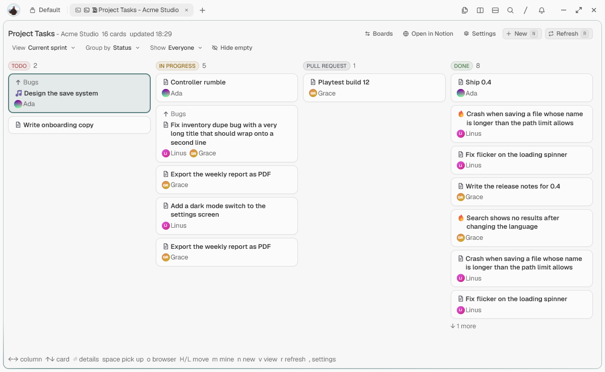
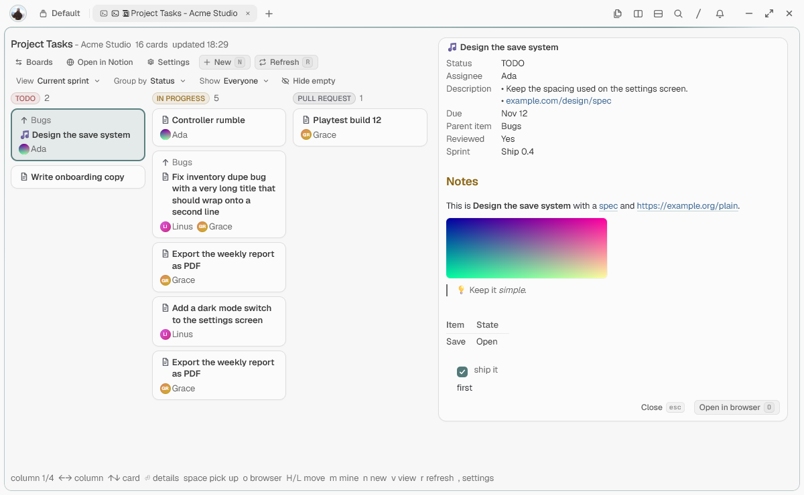

# Notion Kanban for Tern

A [Tern](https://docs.stencil.so/tern/) plugin that shows a Notion board view as a kanban pane. Columns, order, card properties and the view's filter and sort come from the view itself.

## Setup

1. Install the plugin: `tern plugin install github.com/emerycp/tern-notion-kanban`. Tern reloads its plugins, and **Open Notion board** shows up in the palette.
2. Create an internal integration at <https://www.notion.so/profile/integrations> with **Read content**, **Update content**, **Insert content** and, for the full assignee list, **Read user information**.
3. In Notion, open the database, then **••• › Connections** and add the integration.
4. Give Tern the token: **Set Notion token…** in the palette, paste it into a Notion pane, or set `NOTION_TOKEN`. A token set in Tern wins. It is stored in plain text in `<state>/plugin-data/notion/kv.json`.
5. Point a pane at a board view (keep the `?v=` in the link):
   - **Open Notion board from link…**, or paste the link into an open pane.
   - Or put `{ "board": "https://www.notion.so/…?v=…" }` in `.tern/notion.json` and run **Open Notion board** (`Ctrl+Alt+Shift+M`).
   - Or open a pane with no board: with a token set it lists the databases the integration can see, to pick from.

## Keys

| Key | Does |
| --- | --- |
| `←→` `↑↓` (or `hjkl`), `g` / `G` | Move between columns and cards |
| `Enter` / `Esc` | Open / close the card's panel |
| `o`, `b` | Open the card, the board, in the browser |
| `H` / `L` | Move the card to the previous / next column |
| `Space` | Pick the card up, `←→` to choose a column, `Enter` or click to drop, `Esc` to cancel |
| `n` | New card: title, status, sprint (defaults to the current one), parent, assignee. `Tab` between fields, `←→` to change one |
| `v` / `V` | Next / previous board view |
| `m` | Only your cards / everyone's |
| `e` | Hide / show empty columns (off by default) |
| `r` | Refresh (also every minute and after a move) |
| `B` | Pick another board: the databases the integration can see, each with its icon (the default one when it has none) and the project (top-level page) it lives in. `r` reads the list again, `Esc` goes back |
| `,` | Settings |

The second row of the header holds the view options, each named: **View**, **Group by** (changing the view goes back to that view's own grouping), **Show** (whose cards) and **Hide empty**. The first row has the board actions: **Boards**, **Open in Notion**, **Settings**, **New**, **Refresh**.

Tern's block views have no pointer-drag events, so there is no mouse drag and drop; picking a card up is the substitute.

`m` needs to know who you are. It uses the Notion person named like your system user, else the first name you pick in the people menu after pressing `m`.

## Settings

Tern's Preferences › Plugins page only has a switch, Reload and Install for a plugin, so the plugin's own settings are in the pane: the **Settings** button in the header, or `,`. There you can see where the token comes from and forget a saved one (to replace it, paste the new token into the pane), see and change the board, and switch **Hide empty columns** and the daily **update check**. Boards and options are saved with the pane; the token and the update setting are shared by every Notion pane.

## Limits

- 500 cards per read.
- Group by works on Status, Select, Multi-select, People, Relation and Checkbox properties. When a card has several values (several assignees, say) it sits under the first. Moving it puts the target first and drops the one it leaves. Hidden empty columns come back while you carry a card.
- The sprint field in the new-card form, and grouping by sprint, only show when the board has a sprint relation whose sprints can be read.
- The parent line looks for a relation named `Parent item` or `Parent task`.
- Icons: emoji, Notion's built-in icons and uploaded or linked pictures show on the board list, the header and the cards. Tern shrinks big pictures with a basic filter, so a large logo can look jagged; upload a small one (128 to 256 pixels) for a clean result.
- A token belongs to one Notion workspace, so the board list shows that workspace's databases only.

## Development

`tern plugin link .`, then edit; Tern reloads on save. For luau-lsp, `tern plugin types .` writes `tern.d.luau` here (git ignores it). To try it without a real workspace, point it at a fake server: `NOTION_API_BASE` replaces the Notion API, `NOTION_ICONS_BASE` the address of Notion's built-in icons, `NOTION_UPDATE_URL` the file the update check reads.

## Updates

Tern doesn't update plugins by itself, so the plugin looks for you. Once a day it reads the `version` in this repository's `plugin.toml` (on `main`). When that is newer than the installed version, a line with an **Update** button appears at the bottom of the board.

- **Update** runs `tern plugin install github.com/emerycp/tern-notion-kanban --force`, which replaces the installed copy and reloads the plugin. If that can't be done (a copy linked with `tern plugin link`, `tern` not on the path) it copies the command so you can run it in a terminal. You can always run it yourself.
- **Later** hides the line until the next version.
- The check only asks GitHub for that one file, once a day. Turn it off in the settings, or set `NOTION_NO_UPDATE_CHECK=1`.
- A new version means a higher `version` in `plugin.toml` pushed to `main`; without that bump nobody gets the notice.

## License

MIT, see [LICENSE](LICENSE).
